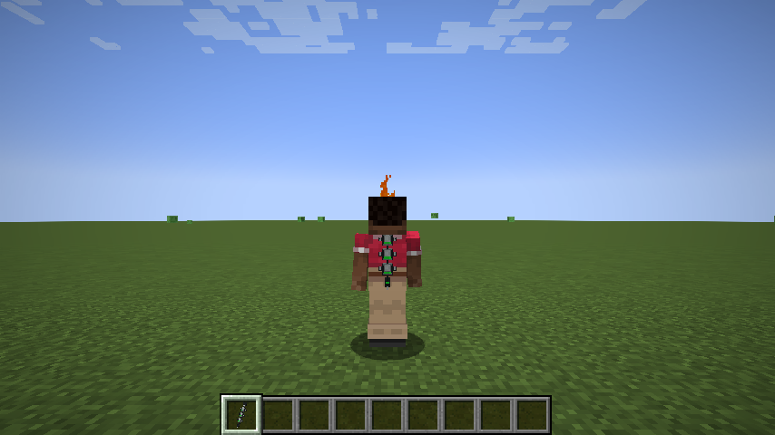
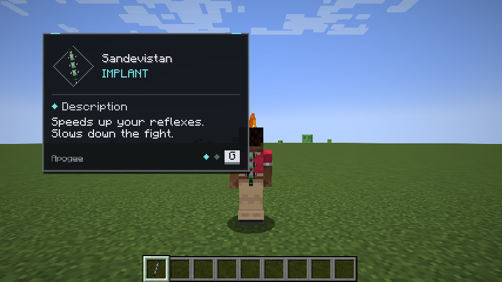
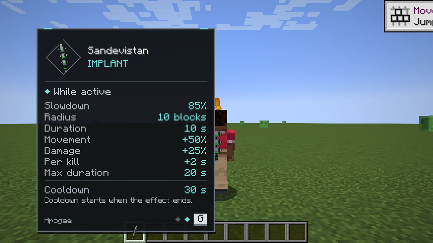
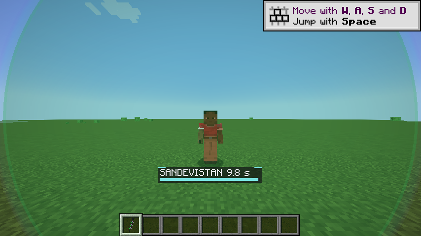
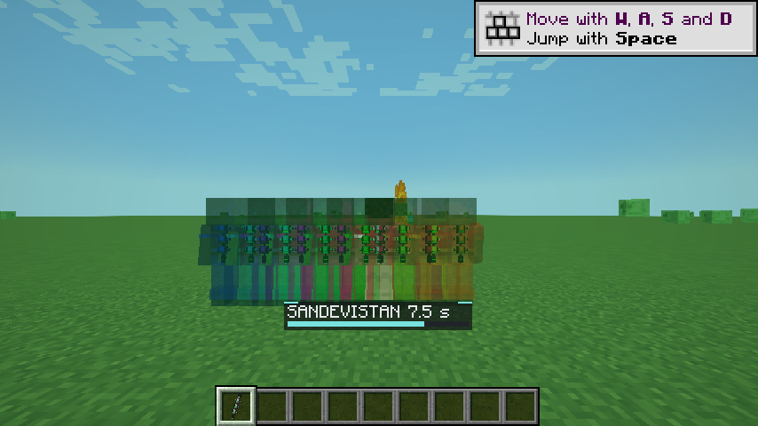
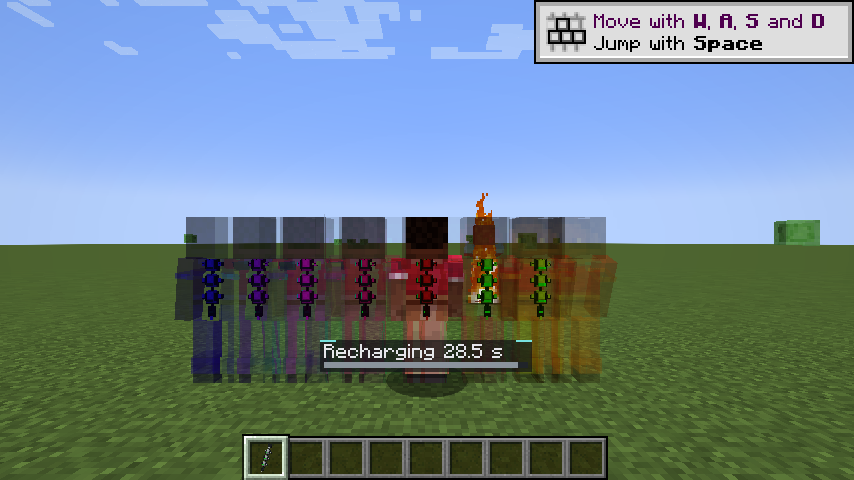

# Resultados de pruebas — Apogee 0.1.0 (2026-09-14)

Entorno: Windows 11, Temurin 21.0.12, Gradle 9.5.1, Loom 1.17.20, Fabric Loader 0.19.3, Fabric API 0.116.17+1.21.1, Trinkets 3.10.0, Simply Tooltips 0.1.5, Architectury 13.0.11, Fzzy Config 0.7.6+1.21, Fabric Language Kotlin 1.13.13.

## Resumen

| Área | Resultado | Cómo |
|---|---|---|
| Compilación y JAR | ✅ `build/libs/apogee-0.1.0+1.21.1.jar` | `gradlew build` |
| Mecánica de servidor | ✅ 15/15 | `gradlew runGametest` |
| Cliente integrado (individual) | ✅ flujo completo y capturas | `gradlew runSmokeClient` |
| Servidor dedicado de desarrollo | ✅ arranca y se detiene | `gradlew runServer` |
| Servidor dedicado de producción | ✅ arranca con el JAR de entrega + Fabric API + Trinkets | `fabric-server-launch.jar` local |
| Remapeo de producción | ✅ mixins, shadows, accessor y descriptor de Simply Tooltips en nombres intermedios | inspección con `javap` |
| Cliente de producción (launcher real) | ⏳ pendiente | ver lista manual |
| Sesión real con Essential | ⏳ pendiente | ver lista manual |

## GameTests (servidor, jugadores simulados)

| Prueba | Verifica |
|---|---|
| `recipesProduceOneItem` | 4 recetas, 1 unidad, 9 ingredientes; implante no apilable y sin durabilidad; componentes apilables |
| `implantUsesCyberwareSlotAndKeepsArmor` | ranura única `cyberware/os`, élitros equipados a la vez, segundo implante sin hueco |
| `activationRequiresImplantAndStartsCooldownOnManualEnd` | sin implante no activa; 10 s; +50 % de velocidad exacto; fin manual restaura velocidad y fija 30 s; bloqueo durante recarga; recarga guardada en el NBT del jugador |
| `expiresAfterDuration` | termina a los 10 s (±2 ticks) |
| `unequipEndsAndCleansUp` | desequipar termina, limpia ralentización y modificador, inicia recarga |
| `deathEndsEffect` | morir termina el efecto |
| `fieldSlowsOnlyCombatants` | zombi que apunta al portador avanza ~15 ticks de 100; zombi inactivo y vaca 100/100; fuera del radio no seleccionado; jugador en supervivencia ralentizado, creativo no, portador nunca; tras terminar vuelve el ritmo normal |
| `fieldFollowsWearerAndReleasesOnExit` | el campo sigue al portador y libera al salir |
| `recentDamageExchangeSelectsMonster` | un esqueleto golpeado entra en el campo y sale al pasar los 10 s de memoria |
| `activeWearersAreImmuneToEachOther` | un portador inactivo se ralentiza, puede activar dentro del campo y ambos quedan inmunes |
| `projectilesFollowOwnership` | proyectil del portador y de un combatiente ralentizados; sin dueño (dispensador) no; bonus marcado solo en proyectiles del portador activo |
| `meleeAndProjectileDamageBonus` | 4 → 4 inactivo, 4 → 5 activo; flecha lanzada durante la activación conserva +25 % tras terminar |
| `killsExtendUpToMaximum` | +2 s por baja atribuida; animales, fuera del campo y muertes no atribuidas no extienden; tope en 20 s |
| `hoppersKeepGlobalRhythm` | una tolva junto a un campo activo mueve ≥9 objetos en 80 ticks |
| `fieldCostWithSeveralWearers` | 4 portadores y 160 zombis ralentizados: **0,145 ms/tick** del gestor |

Nota de entorno: Cardinal Components expulsa a los jugadores simulados por no tener cliente; un mixin exclusivo de las pruebas los mantiene conectados.

## Prueba de cliente automatizada

Mundo plano individual, idioma inglés, 854×480. Comprobaciones: implante equipado, estado activo recibido, jugador listado como portador, zombi que apunta ralentizado en el cliente, fin manual recibido y bandera limpiada. Resultado `APOGEE_SMOKE_PASSED`.

| Captura | Observado |
|---|---|
|  | Columna del implante en la espalda |
|  | Tooltip, vista Descripción: modelo 3D en rombo, nombre, distintivo, marca Apogee, indicadores y G |
|  | Vista Estadísticas con valores sincronizados, separador y nota de recarga |
|  | Transición radial y HUD de duración |
|  | Tinte, HUD y estelas arcoíris |
|  | HUD de recarga y estelas desvaneciéndose |

Comparado con la maqueta: coinciden colores, marco, jerarquía y navegación. Diferencias menores: el modelo es algo más pequeño y la tipografía es la de Minecraft.

## Detalles a resolver

- [ ] Regla con varios portadores: quien porte el Sandevistan no debe ralentizarse, pero sí recibir velocidad y daño; dos portadores no duplican la ralentización. Actualmente, un portador inactivo dentro de otro campo sí se ralentiza.
- [ ] Revisar el tooltip en juego y ajustarlo.
- [ ] Rediseñar las barras de uso y de recarga del HUD.

## Pendiente: pruebas manuales

No se declara compatibilidad con Essential hasta completar esta lista.

### Individual (cliente de producción)

- [ ] Instancia con los mods exactos del README, idioma español: tooltip en español y escala de interfaz 1–4 sin salirse de pantalla.
- [ ] Conflictos de teclas en *Opciones → Controles* para V y G con el modpack real.
- [ ] Armadura, élitros y cosméticos de Essential junto al implante.
- [ ] Pausa (Esc) congela duración y recarga.
- [ ] Granja real (hierro/mobs) antes y durante la activación; excepción del monstruo que te detecta.

### Essential (anfitrión + invitado + observador)

- [ ] El anfitrión activa: el invitado en supervivencia dentro de 10 bloques se mueve, ataca y anima al 15 %; su cámara y menús siguen fluidos; no hay expulsión por vuelo al saltar.
- [ ] El invitado activa: el anfitrión se ralentiza.
- [ ] Activación simultánea: ninguno se ralentiza.
- [ ] El observador ve estelas de ambos, audio de entrada/salida y la espalda del implante.
- [ ] Proyectiles (arco) de ambos dentro y fuera del campo; sin daño duplicado.
- [ ] Entrar al campo durante un efecto ya activo.
- [ ] Desconectar y reconectar el invitado durante el efecto y durante la recarga (la recarga no se reinicia).
- [ ] Cerrar y reabrir el mundo: sin ralentizaciones residuales.
- [ ] Latencia: sin correcciones continuas de posición de jugadores ralentizados.
- [ ] Rendimiento con varios jugadores y estelas (F3 / spark).
