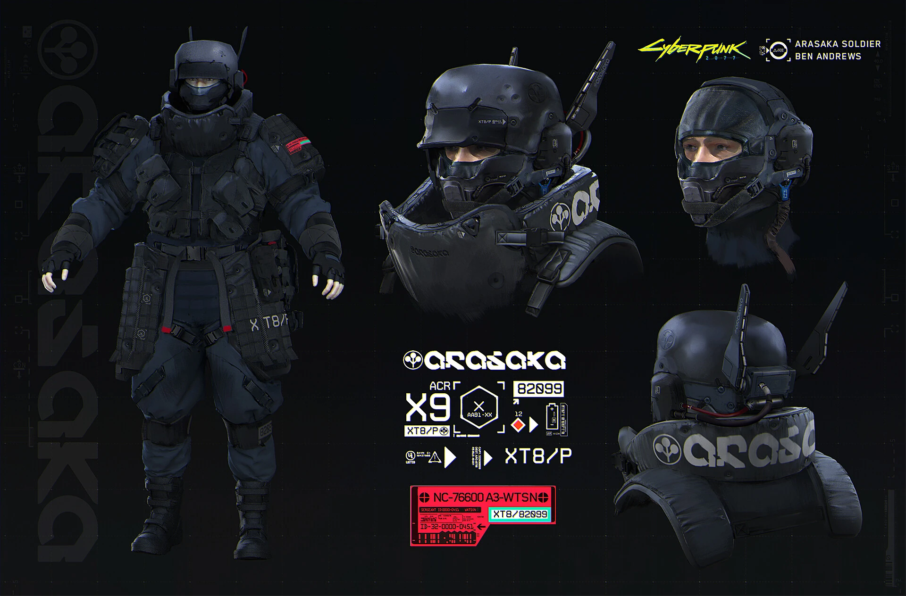

# Arasaka — soldado táctico y seguridad corporativa

Actualizado: 2026-10-23. Base principal: Cyberpunk 2077. **Preparado para iniciar el diseño de armadura.**

## Qué conjunto conviene modelar

Primero, el soldado de casco cerrado y cuello blindado: se reconoce por su silueta incluso a distancia. Usar `arasaka-06` como guía de diseño y `arasaka-04` para comprobar su apariencia en el juego. La seguridad con traje (`01–02`) y la seguridad táctica de Jan Marek (`05`) son variantes distintas, no piezas intercambiables de un único uniforme.

## Lectura visual comprobada

| Pieza | Observación en las imágenes | Traslado propuesto a Blockbench |
|---|---|---|
| Cabeza | Casco oscuro, visor, protección de mandíbula y pequeños módulos laterales (`06`) | Carcasa cúbica biselada por escalones, franja de visor y dos módulos; evitar muchos cubos diminutos |
| Torso | Collar alto, protección pectoral, correas y hombros reforzados (`04–06`) | Collar unido al torso; casco unido a la cabeza. Pechera central y hombreras independientes |
| Cadera y piernas | Paneles protectores colgantes, pantalón oscuro y zonas de rodilla diferenciadas (`04`) | Dos faldones laterales cortos ligados a las piernas; costuras y pliegues en textura |
| Pies | Calzado oscuro y refuerzos de espinilla; rojo visible en algunos detalles (`04`) | Puntera y suela diferenciadas, sin tapar la separación entre piernas |
| Marca | Textos claros y acentos rojos; la lámina `06` incluye muestras de grafismo | Priorizar un emblema pequeño legible; no intentar meter todos los textos |

Las capturas de traje tienen iluminación azulada: no deben usarse como prueba de que toda la armadura sea azul. El contraste negro/gris y rojo es más útil para este soldado concreto. Los distintivos históricos de rango, crisantemo y cuello de la documentación anterior no se han corroborado en estas variantes de 2077.

## Paleta de trabajo propuesta

`#171B20` base · `#343D46` placas · `#626D77` cantos · `#B92D32` rojo · `#D4D8D8` marcas. Son colores elegidos para pixel art, no códigos oficiales ni muestras calibradas.

## Prioridades y límites

Conservar: collar, casco, hombros y faldones. Simplificar: cableado fino, hebillas, textos técnicos y pliegues. El casco necesita espacio para girar sobre el collar; probar mirada arriba/abajo y brazos levantados. La katana y las armas son accesorios externos a esta ficha.

La lámina `05` ofrece espalda de seguridad táctica, pero no demuestra todos los detalles posteriores del soldado `06`. Si se combinan, etiquetar el resultado como adaptación de Apogee. No usar `07` (2020) para completar silenciosamente un hueco de 2077.

## Fuentes principales

- [Ben Andrews — Arasaka Soldier](https://benandrewsart.artstation.com/projects/8exZOO): concepto de producción; colaboración con Jan Marek y dirección de Paweł Mielniczuk, confirmadas en el portfolio.
- [Arasaka — contexto y variantes históricas](https://cyberpunk.fandom.com/wiki/Arasaka): fuente secundaria; las observaciones de forma de esta ficha proceden de las imágenes inspeccionadas abajo.

## Referencia visual principal

Concepto de Ben Andrews: soldado, casco, cuello y marcas. Referencia principal.

## Catálogo local de imágenes

Cada imagen fue descargada y examinada el 2026-10-23. Los enlaces de origen y los archivos de imagen son verificaciones diferentes: el CDN respondió con una imagen válida; varias páginas de Fandom bloquearon la lectura automatizada.

| ID / archivo local | Qué aporta | Fuente y descarga |
|---|---|---|
| [arasaka-01](imagenes/arasaka/arasaka-01.png) · 720 × 1080 | Seguridad corporativa con traje, camisa roja y visor. No es un soldado con casco. | [Origen](https://cyberpunk.fandom.com/wiki/File:Arasaka_Male_guard_v2.png) · [Imagen](https://static.wikia.nocookie.net/cyberpunk/images/0/07/Arasaka_Male_guard_v2.png/revision/latest?cb=20210207232051) |
| [arasaka-02](imagenes/arasaka/arasaka-02.png) · 665 × 1080 | Variante de traje con gafas; útil para una segunda apariencia formal. | [Origen](https://cyberpunk.fandom.com/wiki/File:Arasaka_Male_guard_v4.png) · [Imagen](https://static.wikia.nocookie.net/cyberpunk/images/7/74/Arasaka_Male_guard_v4.png/revision/latest?cb=20210207232118) |
| [arasaka-03](imagenes/arasaka/arasaka-03.png) · 1802 × 1080 | Hombreras y mangas en pose de combate; piernas parcialmente ocultas. | [Origen](https://cyberpunk.fandom.com/wiki/File:Arasaka_Guards_Assault_2077.png) · [Imagen](https://static.wikia.nocookie.net/cyberpunk/images/2/2a/Arasaka_Guards_Assault_2077.png/revision/latest?cb=20210115224056) |
| [arasaka-04](imagenes/arasaka/arasaka-04.png) · 1920 × 1080 | Soldados del juego: negro, rojo, cuello alto y placas colgantes de cadera. | [Origen](https://cyberpunk.fandom.com/wiki/File:Arasaka_Soldiers_p1.png) · [Imagen](https://static.wikia.nocookie.net/cyberpunk/images/8/86/Arasaka_Soldiers_p1.png/revision/latest?cb=20210323202427) |
| [arasaka-05](imagenes/arasaka/arasaka-05.jpg) · 1920 × 873 | Lámina de Jan Marek: seguridad táctica con frente, espalda y vistas oblicuas. | [Origen](https://cyberpunk.fandom.com/wiki/File:CP2077_Arasaka_troops_concept.jpg) · [Imagen](https://static.wikia.nocookie.net/cyberpunk/images/8/83/CP2077_Arasaka_troops_concept.jpg/revision/latest?cb=20220217191843) |
| [arasaka-06](imagenes/arasaka/arasaka-06.jpg) · 1920 × 1264 | Concepto de Ben Andrews: soldado, casco, cuello y marcas. Referencia principal. | [Origen](https://cyberpunk.fandom.com/wiki/File:Ben-andrews-ben-andrews-arasaka-soldier-cyberpunk2077.jpg) · [Imagen](https://static.wikia.nocookie.net/cyberpunk/images/5/56/Ben-andrews-ben-andrews-arasaka-soldier-cyberpunk2077.jpg/revision/latest?cb=20210825012825) |
| [arasaka-07](imagenes/arasaka/arasaka-07.png) · 363 × 884 | Ilustración de Cyberpunk 2020, no uniforme de 2077; autor individual pendiente. | [Origen](https://cyberpunk.fandom.com/wiki/File:Arasaka_Soldier.png) · [Imagen](https://static.wikia.nocookie.net/cyberpunk/images/9/92/Arasaka_Soldier.png/revision/latest?cb=20201001024318) |

Créditos por imagen, tamaño y huella SHA-256: [manifest de referencias](referencias.json). [Volver al índice](README.md) · [Abrir galería](galeria.html).
