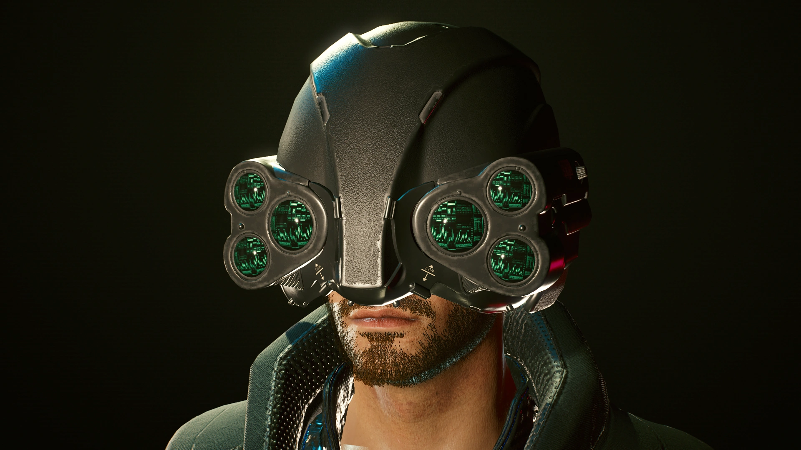

# MaxTac — equipo táctico de 2077

La selección del usuario ya tiene una [primera versión editable y equipable](../../art/maxtac/LEEME.md), modelada y exportada en Blockbench para GeckoLib. El casco deja descubiertos labios y mentón, tiene seis ópticas circulares, acabado negro uniforme y protector nasal fino. Dos ópticas están encendidas al equiparlo y **N** alterna las cuatro auxiliares. Las mangas llevan bandas violetas continuas con brillo propio. La cobertura se amplió y revisó dentro de Minecraft con skins clásicas y delgadas y sus capas exteriores activas. Las siete referencias documentadas abajo se complementan con las imágenes añadidas por el usuario y su selección guardada en `art/maxtac/referencias-seleccionadas.json`.

## Variante recomendada

Tomar el conjunto equipable SQ030 como base consistente (`01–06`) y la captura oficial `07` para comprobar volumen en movimiento. No mezclar automáticamente sus bandas de color con todas las versiones de los NPC ni con diseños del teaser de 2013, Edgerunners o mods de aficionados.

## Lectura visual y adaptación propuesta

| Pieza | Observación directa | Decisión propuesta para Blockbench |
|---|---|---|
| Casco | Carcasa oscura, centro vertical que cubre frente/nariz y seis ópticas laterales (`03`) | Dos módulos de tres lentes; conservar la silueta ancha y el centro estrecho |
| Nuca | Cobertura posterior segmentada, bandas y placas (`04`) | Dos o tres niveles de carcasa; resto en textura |
| Torso | Chaleco negro, cuello levantado y superficies de tejido técnico (`01–02`) | Pechera rectangular ligeramente voluminosa y collar independiente del casco |
| Brazos | Mangas oscuras, refuerzos y franjas violetas en el conjunto equipable (`01`) | Bandas continuas en relieve y emisión propia, según la elección del usuario; sin proyectar luz sobre el entorno |
| Piernas | Pantalón negro, correas y protecciones de rodilla (`05–06`) | Rodilleras y correas diferenciadas; liberar la entrepierna para animaciones |
| Botas | Las imágenes de pantalón recortan los pies | Diseñar provisionalmente calzado oscuro compatible; marcarlo como reconstrucción hasta obtener referencia completa |

La paleta del modelo se guarda en `art/maxtac/source/materiales.json`: casco carbón uniforme, traje azul muy oscuro, ópticas verdes y bandas violeta `#BC78FF`. Son elecciones de adaptación, no colores oficiales medidos. La captura oficial está iluminada por disparos y neón: usarla para volumen, no para medir colores exactos.

## Prioridades

El casco multióptico debe distinguir a MaxTac incluso sin logos. La versión actual utiliza seis tambores de sección circular y biseles de dieciséis segmentos, conforme a la corrección del usuario. Queda por revisar los extremos de giro y la convivencia visual de los antebrazos con las Cuchillas Mantis y el Nanocable de Apogee.

Las cuatro piezas están disponibles en creativo, con estadísticas de netherita provisionales y con receta propia. Las botas son una adaptación provisional; las variantes de especialistas quedan para después de revisar el conjunto base.

## Fuentes

- [Captura MaxTac — CDN oficial de CD PROJEKT RED](https://cdn-l-cyberpunk.cdprojektred.com/gallery/1080p/Cyberpunk2077_Max_Tac_prevention_at_RGB-en.jpg): fuente primaria visual, descargada y examinada.
- [Cyberpunk 2077 — sitio oficial, sección Media](https://www.cyberpunk.net/en/cyberpunk-2077): contexto del material de producción.
- [Categoría de imágenes de equipo](https://cyberpunk.fandom.com/wiki/Category%3ACyberpunk_2077_images_-_Equipment): enumera los seis archivos SQ030; es el índice utilizado para localizarlos.
- [MaxTac](https://cyberpunk.fandom.com/wiki/MaxTac) y [galería de MaxTac](https://cyberpunk.fandom.com/wiki/MaxTac/Gallery): referencias secundarias. La galería bloqueó la lectura automatizada; no se presenta como leída íntegramente.

## Imágenes locales

| Imagen | Uso | Fuente |
|---|---|---|
| [maxtac-01](imagenes/maxtac/maxtac-01.png) · 1920 × 1080 | Chaleco oscuro, cuello levantado, mangas y bandas violetas visibles en esta variante equipable. | [Origen](https://cyberpunk.fandom.com/wiki/File:SQ030_MaxTac_ChestM_Front_CP2077.png) |
| [maxtac-02](imagenes/maxtac/maxtac-02.png) · 1920 × 1080 | Espalda del chaleco: panel central y textura de tejido; buena guía para el relieve posterior. | [Origen](https://cyberpunk.fandom.com/wiki/File:SQ030_MaxTac_ChestM_Rear_CP2077.png) |
| [maxtac-03](imagenes/maxtac/maxtac-03.png) · 1920 × 1080 | Casco con seis lentes agrupadas a ambos lados de la cara. Referencia principal del casco. | [Origen](https://cyberpunk.fandom.com/wiki/File:SQ030_MaxTac_HelmetM_Front_CP2077.png) |
| [maxtac-04](imagenes/maxtac/maxtac-04.png) · 1920 × 1080 | Nuca del casco: placas, bandas y cobertura; complementa la vista frontal. | [Origen](https://cyberpunk.fandom.com/wiki/File:SQ030_MaxTac_HelmetM_Rear_CP2077.png) |
| [maxtac-05](imagenes/maxtac/maxtac-05.png) · 1920 × 1080 | Pantalón oscuro, refuerzos de rodilla y correas; pies recortados. | [Origen](https://cyberpunk.fandom.com/wiki/File:SQ030_MaxTac_PantsM_Front_CP2077.png) |
| [maxtac-06](imagenes/maxtac/maxtac-06.png) · 1920 × 1080 | Espalda del pantalón; pies recortados y detalle fino de suelas no documentado. | [Origen](https://cyberpunk.fandom.com/wiki/File:SQ030_MaxTac_PantsM_Rear_CP2077.png) |
| [maxtac-07](imagenes/maxtac/maxtac-07.jpg) · 1920 × 1080 | Casco multióptico, cuello y brazo en acción; iluminación cinematográfica, no referencia neutra de color. | [Origen](https://cdn-l-cyberpunk.cdprojektred.com/gallery/1080p/Cyberpunk2077_Max_Tac_prevention_at_RGB-en.jpg) |

[Volver a la galería](galeria.html) · [Guía de Blockbench](GUIA_BLOCKBENCH.md) · [Registro de procedencia](referencias.json).
