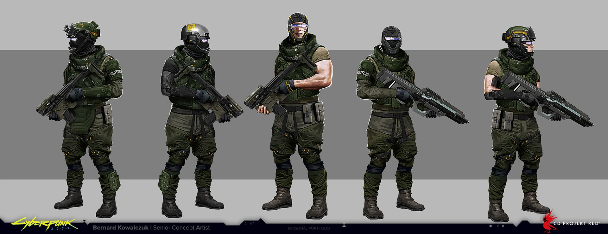

# Militech — operador militar de 2077

Actualizado: 2026-10-23. **Preparado para iniciar el diseño; espalda parcialmente documentada.**

## Qué conjunto conviene modelar

El operador verde oliva de `militech-01`, con casco de `02` o `03`. Elegir una variante de visor antes de empezar: cerrado, ocular pequeño o rostro abierto. No superponer las tres. El ingeniero `04` sirve como variante de trabajo; su pantalón hexagonal no define a todos los soldados.

## Lectura visual comprobada

| Pieza | Observación en las imágenes | Traslado propuesto a Blockbench |
|---|---|---|
| Casco | Carcasa oliva, orejeras voluminosas, piezas oscuras y franjas amarillas (`02–03`) | Bóveda escalonada, dos cajas laterales y visera frontal. Amarillo en textura |
| Visor | Negro en la versión cerrada; reflejo violeta en el ocular pequeño (`02`) | Banda oscura opaca; reflejo de dos o tres tonos. Transparencia solo si se decide implementarla |
| Torso | Chaleco modular, cuello textil, bolsas y correas sobre uniforme oliva (`01`) | Pechera rectangular, pocas bolsas grandes, cinturón y collar bajo |
| Brazos | Variantes con mangas, brazos expuestos y guantes (`01`) | Fijar una sola variante inicial de mangas completas; refuerzos ligados a cada brazo |
| Piernas | Pantalón de campaña, bolsillos y rodilleras diferenciadas (`01`) | Bolsillos laterales poco profundos; rodilleras en la parte frontal de cada pierna |
| Botas | Oscuras, robustas, de caña visible (`01`) | Suela gruesa y puntera; cordones sugeridos con píxeles |
| Insignia | MILITECH legible en la visera de una variante (`03`) | Marca frontal clara o abreviación gráfica si la resolución no admite letras |

## Paleta de trabajo propuesta

`#343C2B` oliva oscuro · `#586347` tela/placas · `#202624` juntas · `#9AA18B` luces · `#D7B642` señales. Ocular opcional `#6D68AC`. Propuesta para Minecraft, no paleta corporativa oficial.

## Prioridades y límites

La identidad debe venir del oliva, el casco con módulos laterales y las bolsas de equipo. A diferencia de una armadura ceremonial, el volumen se concentra en chaleco y carga. Mantener espacio entre bolsas, cintura y muslos durante la caminata.

No hay en la colección una espalda ortográfica limpia del operador elegido. Para un primer modelo se puede proponer espalda simple con correas y panel, pero será una reconstrucción de Apogee. Las ilustraciones `05–07` son de 2020; no completar con ellas un casco de 2077. El nombre M-88 no identifica automáticamente el casco de las láminas modernas.

## Fuentes principales

- [Bernard Kowalczuk — Militech](https://bernard.artstation.com/projects/EL0rJ0): portfolio del artista, con diseños de casco y operadores; dirección de Paweł Mielniczuk.
- [Militech — contexto de la corporación](https://cyberpunk.fandom.com/wiki/Militech): fuente secundaria; usar las láminas para la forma y los colores del conjunto elegido.

## Referencia visual principal

Operadores: oliva, equipo modular, rodilleras y botas; falta espalda limpia.

## Catálogo local de imágenes

Cada imagen fue descargada y examinada el 2026-10-23. Los enlaces de origen y los archivos de imagen son verificaciones diferentes: el CDN respondió con una imagen válida; varias páginas de Fandom bloquearon la lectura automatizada.

| ID / archivo local | Qué aporta | Fuente y descarga |
|---|---|---|
| [militech-01](imagenes/militech/militech-01.jpg) · 1920 × 742 | Operadores: oliva, equipo modular, rodilleras y botas; falta espalda limpia. | [Origen](https://cyberpunk.fandom.com/wiki/File:CP2077_Militech_operatives_concept_art.jpg) · [Imagen](https://static.wikia.nocookie.net/cyberpunk/images/b/b5/CP2077_Militech_operatives_concept_art.jpg/revision/latest?cb=20210523214732) |
| [militech-02](imagenes/militech/militech-02.jpg) · 1920 × 679 | Variantes de visor cerrado, ocular y rostro abierto. No es una vista trasera ortográfica. | [Origen](https://cyberpunk.fandom.com/wiki/File:CP2077_Militech_helmet_concept_1.jpg) · [Imagen](https://static.wikia.nocookie.net/cyberpunk/images/9/90/CP2077_Militech_helmet_concept_1.jpg/revision/latest?cb=20210523214739) |
| [militech-03](imagenes/militech/militech-03.jpg) · 1920 × 679 | Visera frontal con MILITECH y módulos laterales; diferentes posiciones. | [Origen](https://cyberpunk.fandom.com/wiki/File:CP2077_Militech_helmet_concept_2.jpg) · [Imagen](https://static.wikia.nocookie.net/cyberpunk/images/e/e4/CP2077_Militech_helmet_concept_2.jpg/revision/latest?cb=20210523214756) |
| [militech-04](imagenes/militech/militech-04.png) · 708 × 1080 | Ingeniero del juego con pantalón de patrón hexagonal; no generalizarlo a toda la tropa. | [Origen](https://cyberpunk.fandom.com/wiki/File:Militech_Field_Engineer_Infobox_CP2077.png) · [Imagen](https://static.wikia.nocookie.net/cyberpunk/images/e/e2/Militech_Field_Engineer_Infobox_CP2077.png/revision/latest?cb=20210828220144) |
| [militech-05](imagenes/militech/militech-05.png) · 334 × 794 | Soldado de Cyberpunk 2020; referencia histórica, sin colores verificables. | [Origen](https://cyberpunk.fandom.com/wiki/File:Militech_Soldier_p1.png) · [Imagen](https://static.wikia.nocookie.net/cyberpunk/images/1/13/Militech_Soldier_p1.png/revision/latest?cb=20201001024733) |
| [militech-06](imagenes/militech/militech-06.png) · 331 × 844 | EMA-1 de Cyberpunk 2020; no confundir su coraza con el operador de 2077. | [Origen](https://cyberpunk.fandom.com/wiki/File:Militech_soldier_p2.png) · [Imagen](https://static.wikia.nocookie.net/cyberpunk/images/e/e3/Militech_soldier_p2.png/revision/latest?cb=20201001024759) |
| [militech-07](imagenes/militech/militech-07.jpeg) · 573 × 696 | M-88 histórico; la imagen monocroma no confirma colores. | [Origen](https://cyberpunk.fandom.com/wiki/File:Militech_M-88_Revised_Combat_Helmet.jpeg) · [Imagen](https://static.wikia.nocookie.net/cyberpunk/images/b/be/Militech_M-88_Revised_Combat_Helmet.jpeg/revision/latest?cb=20230627091509) |

Créditos por imagen, tamaño y huella SHA-256: [manifest de referencias](referencias.json). [Volver al índice](README.md) · [Abrir galería](galeria.html).
