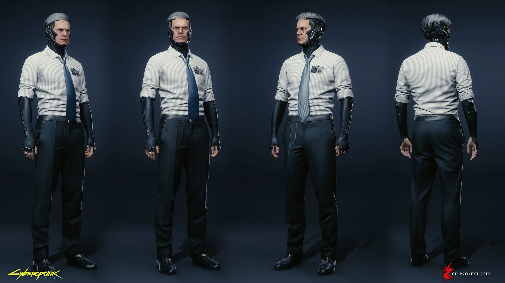

# NetWatch — agente con cyberware expuesto

Actualizado: 2026-10-23. **Referencia de cuerpo completo localizada y revisada.**

## Qué conjunto conviene modelar

El agente de `netwatch-04`: camisa clara con mangas recogidas, corbata, pantalón oscuro y zapatos. Tiene cyberware visible en cabeza, cuello y brazos. Esta apariencia ofrece una identidad propia sin convertirlo en otro soldado de casco militar. Su traducción a cuatro ranuras de armadura es una decisión jugable de Apogee, no evidencia de un uniforme blindado de cuatro piezas.

## Lectura visual comprobada

| Zona | Evidencia | Traslado propuesto a Blockbench |
|---|---|---|
| Cabeza | Rostro descubierto e implantes en sienes, mandíbula y nuca (`01–02`, concepto) | Aro abierto o placas laterales que dejen visible la cara de la skin |
| Cuello | Estructura mecánica oscura y cableado rojo/naranja en concepto | Collar estrecho, pocas placas y líneas de textura; no modelar una cabeza humana fija |
| Torso | Camisa clara, cuello de camisa y corbata en el modelo final (`04`) | Superficie ajustada; corbata y botones en textura, cuello con relieve mínimo |
| Brazos | Antebrazos cibernéticos oscuros bajo mangas recogidas (`04`) | Brazales divididos por brazo; tratar su apariencia como recubrimiento equipable |
| Piernas | Pantalones oscuros de corte formal; se ven frente, perfil y espalda (`04`) | Piernas estrechas y rectas, cinturón en textura |
| Pies | Zapatos negros de perfil bajo (`04`) | Puntera discreta, sin convertirlos en botas militares |

La imagen `03` enseña la espalda sin camisa para estudiar implantes. No demuestra que esa maquinaria vaya por encima de la ropa del personaje final. Tampoco prueba un casco de NetWatch. Se descartan como pruebas de facción los cascos genéricos “Ultralight helmet with foam padding” y “Scratched heavy netrunner helmet”.

## Paleta de trabajo propuesta

`#D1D5D0` camisa · `#9AA7A5` sombras de tela · `#20252B` pantalón/corbata · `#424B53` implantes · `#BC4935` cableado puntual. La propuesta combina lectura del modelo final y conceptos; no todos los acentos del concepto aparecen igual en el juego.

## Prioridades y límites

Conservar camisa clara, corbata oscura y cuello/antebrazos mecánicos. No copiar el rostro, cabello o tono de piel del NPC dentro de la armadura: debe funcionar con la skin del jugador. Un casco totalmente cerrado sería una variante original, no una reproducción de estas referencias.

La espalda de la camisa y el calzado ya están documentados en `04`; se corrige el pendiente del documento anterior. El detalle fino de las suelas sigue sin estar visible y no es necesario para un primer bloqueo de formas.

## Fuentes principales

- [Marcin Polak — Cyberpunk 2077 / Netwatch](https://polako.artstation.com/projects/L3Vxlv): personaje final; acredita ropa a Wojciech Michalski, brazos a Weronika Przeklasa y render a Maciek Zoń.
- [Furio Tedeschi — NetWatch Agent](https://furio.artstation.com/projects/rAe41O): concepto con Jan Marek. Las variaciones de créditos de cabello entre portfolios no afectan la armadura y no se resuelven aquí.
- [NetWatch — contexto](https://cyberpunk.fandom.com/wiki/NetWatch): fuente secundaria.

## Referencia visual principal

Personaje final: frente, perfil y espalda; incluye pantalones y zapatos. Referencia principal.

## Catálogo local de imágenes

Cada imagen fue descargada y examinada el 2026-10-23. Los enlaces de origen y los archivos de imagen son verificaciones diferentes: el CDN respondió con una imagen válida; varias páginas de Fandom bloquearon la lectura automatizada.

| ID / archivo local | Qué aporta | Fuente y descarga |
|---|---|---|
| [netwatch-01](imagenes/netwatch/netwatch-01.jpg) · 1124 × 1200 | Concepto de implantes de cabeza y cuello; no representa un casco independiente. | [Origen](https://cyberpunk.fandom.com/wiki/File:Furio-tedeschi-cp-netagent-version1-furiotedeschi-25-03-2019.jpg) · [Imagen](https://static.wikia.nocookie.net/cyberpunk/images/8/8f/Furio-tedeschi-cp-netagent-version1-furiotedeschi-25-03-2019.jpg/revision/latest?cb=20210806034552) |
| [netwatch-02](imagenes/netwatch/netwatch-02.jpg) · 1124 × 1200 | Concepto posterior de cabeza: placas negras y cableado rojo/naranja. | [Origen](https://cyberpunk.fandom.com/wiki/File:Furio-tedeschi-cp-netagent-version2backview-furiotedeschi-26-03-2019.jpg) · [Imagen](https://static.wikia.nocookie.net/cyberpunk/images/2/2b/Furio-tedeschi-cp-netagent-version2backview-furiotedeschi-26-03-2019.jpg/revision/latest?cb=20210806034627) |
| [netwatch-03](imagenes/netwatch/netwatch-03.jpg) · 1077 × 1501 | Espalda sin camisa: estudio de cyberware; no es ropa visible sobre la camisa. | [Origen](https://cyberpunk.fandom.com/wiki/File:Furio-tedeschi-cp-netagent-armsrubberback-furiotedeschi-14-04-2019.jpg) · [Imagen](https://static.wikia.nocookie.net/cyberpunk/images/6/68/Furio-tedeschi-cp-netagent-armsrubberback-furiotedeschi-14-04-2019.jpg/revision/latest?cb=20210806034721) |
| [netwatch-04](imagenes/netwatch/netwatch-04.jpg) · 1920 × 1080 | Personaje final: frente, perfil y espalda; incluye pantalones y zapatos. Referencia principal. | [Origen](https://cyberpunk.fandom.com/wiki/File:Marcin-polak-netwatchbody-jpg.jpg) · [Imagen](https://static.wikia.nocookie.net/cyberpunk/images/1/1b/Marcin-polak-netwatchbody-jpg.jpg/revision/latest?cb=20210806034938) |

Créditos por imagen, tamaño y huella SHA-256: [manifest de referencias](referencias.json). [Volver al índice](README.md) · [Abrir galería](galeria.html).
