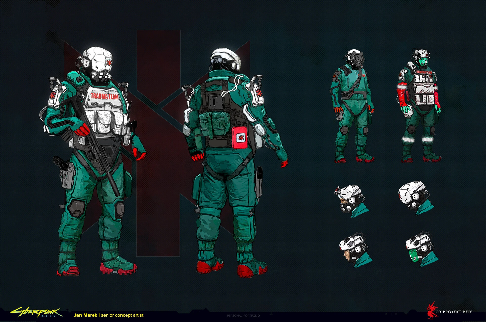

# Trauma Team — equipo de respuesta de 2077

Actualizado: 2026-10-23. **Preparado para modelado; excelente cobertura de casco y cuerpo.**

## Qué conjunto conviene modelar

El equipo de intervención de `trauma-team-02`, complementado por el casco médico `03` y el concepto `05`. La referencia tiene mono verde/turquesa, protección clara, zonas negras y acentos rojos. Para Apogee esta será la variante principal de 2077. El azul/amarillo citado en descripciones de otras épocas no obliga a mezclar ambas paletas.

## Lectura visual comprobada

| Pieza | Observación | Traslado propuesto a Blockbench |
|---|---|---|
| Casco | Carcasa blanca, abertura facial oscura, respirador, luces y módulos laterales (`03–05`) | Volumen blanco grande, visor y respirador separados, dos módulos; una silueta clara desde lejos |
| Torso | Mono verde, chaleco blanco con bolsas, correas y hombros protegidos (`02`) | Pechera clara en relieve, tres o cuatro bolsas legibles y cuello textil |
| Espalda | Correas y equipo posterior en la lámina del conjunto (`02`) | Bloque de carga compacto ligado al torso; no exagerar una mochila inexistente en la variante elegida |
| Brazos | Combinaciones de verde, placas claras y rojo (`02`, `06`) | Mangas y guantes en textura; hombreras separadas para permitir levantar brazos |
| Piernas | Mono de trabajo, rodilleras oscuras y bolsillos (`02`) | Dos rodilleras y bolsillos laterales; mantener libre la entrepierna |
| Botas | Calzado oscuro con refuerzos; rojo visible en el concepto (`02`) | Puntera y suela fuertes, acento rojo limitado |
| Identificación | Texto TRAUMA TEAM y símbolo médico rojo en referencias de casco y torso | Mantener un símbolo legible y una marca de pecho; evitar microtexto ilegible |

## Paleta de trabajo propuesta

`#17685D` verde · `#0E433E` sombra · `#D9E2DC` protección blanca · `#283236` juntas · `#BE3537` rojo. Propuesta para pixel art; las capturas y conceptos tienen iluminación diferente.

## Variantes y límites

`04` es un casco de piloto: conservarlo como alternativa, no como espalda exacta del casco médico. `01` es el uniforme equipable, con imagen pequeña y menos equipo exterior; no representa todo el volumen de un NPC de intervención. `06` es fotografía de una figura: apoyo tridimensional, sin tratar cada accesorio como prueba del modelo del juego. La afirmación previa de “figura oficial” queda retirada hasta comprobar su fabricante.

Modelar primero la versión médica; después variar el visor, casco o carga para seguridad/piloto. No asignar prestaciones de curación, resistencia ni soporte vital al objeto de Minecraft basándose solo en su apariencia.

## Fuentes principales

- [Ben Andrews — Trauma Team](https://benandrewsart.artstation.com/projects/ELR1dA): conceptos con Jan Marek.
- [Marcin Blaszczak — modelo del juego](https://mblaszczak.artstation.com/projects/oAdR3q): acredita concepto a Jan Marek y cascos a Ben Andrews; incluye material de presentación del modelo.
- [Trauma Team — historia](https://cyberpunk.fandom.com/wiki/Trauma_Team) y [uniforme equipable](https://cyberpunk.fandom.com/wiki/Trauma_Team_uniform): fuentes secundarias, distintas del conjunto de NPC.

## Referencia visual principal

Lámina de Jan Marek: frontal, espalda, versiones y equipo. Referencia principal.

## Catálogo local de imágenes

Cada imagen fue descargada y examinada el 2026-10-23. Los enlaces de origen y los archivos de imagen son verificaciones diferentes: el CDN respondió con una imagen válida; varias páginas de Fandom bloquearon la lectura automatizada.

| ID / archivo local | Qué aporta | Fuente y descarga |
|---|---|---|
| [trauma-team-01](imagenes/trauma-team/trauma-team-01.png) · 200 × 400 | Uniforme equipable del juego, imagen pequeña; no basta para el chaleco completo del NPC. | [Origen](https://cyberpunk.fandom.com/wiki/File:Trauma_Team_OutfitM.png) · [Imagen](https://static.wikia.nocookie.net/cyberpunk/images/0/06/Trauma_Team_OutfitM.png/revision/latest?cb=20230922083621) |
| [trauma-team-02](imagenes/trauma-team/trauma-team-02.jpg) · 1920 × 1276 | Lámina de Jan Marek: frontal, espalda, versiones y equipo. Referencia principal. | [Origen](https://cyberpunk.fandom.com/wiki/File:CP2077_Trauma_Team_concept.jpg) · [Imagen](https://static.wikia.nocookie.net/cyberpunk/images/9/91/CP2077_Trauma_Team_concept.jpg/revision/latest?cb=20220217190936) |
| [trauma-team-03](imagenes/trauma-team/trauma-team-03.jpg) · 3448 × 1460 | Casco médico: protección facial, respirador y módulos laterales. | [Origen](https://cyberpunk.fandom.com/wiki/File:CP2077_Trauma_Team_medic_helmet_design.jpg) · [Imagen](https://static.wikia.nocookie.net/cyberpunk/images/4/42/CP2077_Trauma_Team_medic_helmet_design.jpg/revision/latest?cb=20210523204203) |
| [trauma-team-04](imagenes/trauma-team/trauma-team-04.jpg) · 3378 × 1311 | Casco de piloto, laterales y espalda; conservarlo como variante. | [Origen](https://cyberpunk.fandom.com/wiki/File:CP2077_Trauma_Team_pilot_helmet_design.jpg) · [Imagen](https://static.wikia.nocookie.net/cyberpunk/images/a/aa/CP2077_Trauma_Team_pilot_helmet_design.jpg/revision/latest?cb=20210523204213) |
| [trauma-team-05](imagenes/trauma-team/trauma-team-05.jpeg) · 1920 × 850 | Concepto de casco de Ben Andrews; buena lectura de silueta y cuello. | [Origen](https://cyberpunk.fandom.com/wiki/File:Trauma_Team_Helmet_Concept_1.jpeg) · [Imagen](https://static.wikia.nocookie.net/cyberpunk/images/b/b5/Trauma_Team_Helmet_Concept_1.jpeg/revision/latest?cb=20210721213140) |
| [trauma-team-06](imagenes/trauma-team/trauma-team-06.jpg) · 1600 × 1600 | Fotografía de figura publicada en wiki: apoyo de volumen; fabricante y licencia no verificados. | [Origen](https://cyberpunk.fandom.com/wiki/File:Figure_GEAR_Trauma_Team.jpg) · [Imagen](https://static.wikia.nocookie.net/cyberpunk/images/6/61/Figure_GEAR_Trauma_Team.jpg/revision/latest?cb=20261010141920) |

Créditos por imagen, tamaño y huella SHA-256: [manifest de referencias](referencias.json). [Volver al índice](README.md) · [Abrir galería](galeria.html).
