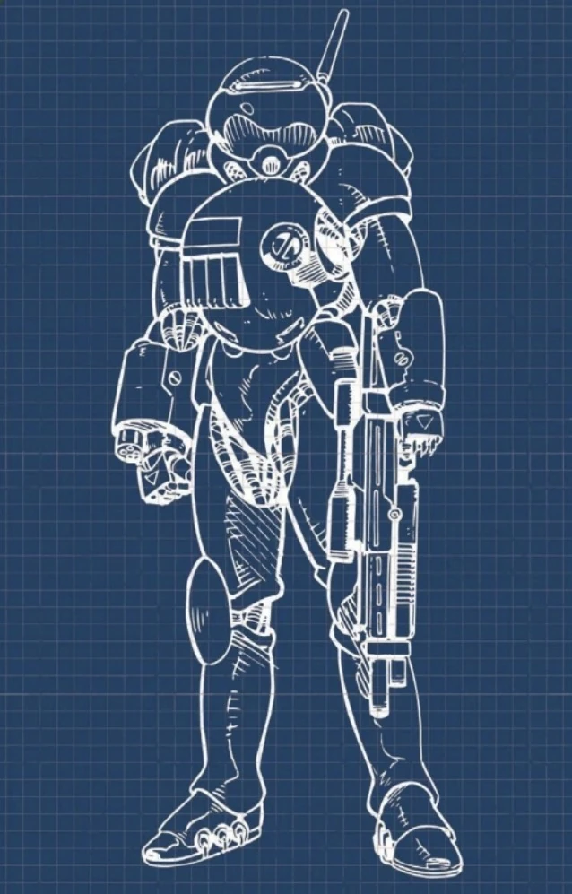

# Zetatech — Grasshopper y referencias de personal

Actualizado: 2026-10-23. **Ya existe una base visual de armadura: Grasshopper.** La estética de un soldado Zetatech de 2077 sigue sin estar suficientemente documentada en esta colección.

## Hallazgo principal: Grasshopper

El [Night Market Index de R. Talsorian Games](https://rtalsoriangames.com/wp-content/uploads/2026/01/RTG-CPR-DLC-NightMarketIndexv1.24.pdf) incluye la **Zetatech Grasshopper** entre las armaduras de combate asistidas y remite a **Interface RED, volumen 5, página 142**. Se comprobó en las páginas 39 y 73 del índice. Esto confirma una opción oficial de armadura; no un uniforme militar de 2077.

La [ficha histórica de Grasshopper](https://cyberpunk.fandom.com/wiki/Zetatech_Grasshopper_(2020)) atribuye la armadura a Zetatech/Dynalar y cita **Maximum Metal, pp. 86–87**, y **Firestorm Shockwave, p. 62**. Las dos imágenes locales proceden del espejo de la wiki: una figura monocroma etiquetada 2020 y otra lámina etiquetada RED. No se ha inspeccionado el libro completo de pago ni confirmado el ilustrador individual.

## Lectura visual comprobada

| Pieza | Visible en `zetatech-01/02` | Traslado propuesto a Blockbench |
|---|---|---|
| Cabeza | Casco redondeado, visor ancho, respirador y antena | Casco escalonado compacto; visor frontal grande, respirador cúbico y antena corta |
| Torso | Coraza voluminosa, panel rectangular y rejilla, hombros grandes | Pechera de dos niveles; rejilla en textura y hombreras separadas |
| Brazos | Antebrazos muy protegidos y manos articuladas | Guanteletes anchos; dedos resueltos en textura sobre la mano de Minecraft |
| Piernas | Muslos relativamente estrechos, rodillas y espinillas protegidas | Contraste entre coraza ancha y piernas menos voluminosas |
| Pies | Extensiones/ruedas visibles en un pie | Detalle lateral opcional; no deducir una mecánica de patinaje ya implementada |

El azul de la segunda imagen es un fondo de plano técnico, **no prueba de que la armadura sea azul**. No se dispone de espalda ni perfil limpio. Para completar esas caras habrá que diseñar una reconstrucción identificada como propia.

## Dirección propuesta para Apogee

Opción recomendada si se desea fidelidad documentada: **Grasshopper reinterpretada a escala Minecraft**, con su época marcada. Paleta provisional propia: `#D0D3CD` placas, `#686F70` metal, `#222C32` articulaciones, `#8CAEB5` visor y `#C2A35A` detalles. Ninguno de estos colores se presenta como oficial.

Si se prefiere una facción homogénea con 2077, crear una variante llamada “Zetatech — adaptación Apogee” y reconocer que la combinación de casco, armadura y paleta es original. Los vehículos sirven para proporciones industriales y panelado, no para inferir uniformes de sus tripulaciones.

## Pistas concretas de 2077 y 2079

**Contiene referencias a misiones y un final de Phantom Liberty.**

- [Hasan Demir](https://cyberpunk.fandom.com/wiki/Hasan_Demir): ingeniero de Zetatech. La ficha describe una rama de “Prototype in the Scraper” en la que soldados corporativos lo escoltan. Es un lugar concreto para obtener capturas futuras; no se ha identificado aquí su equipo con suficiente detalle.
- [Viktor Vektor](https://cyberpunk.fandom.com/wiki/Viktor_Vektor): su relación laboral con Zetatech aparece en un final situado en 2079. No atribuir automáticamente su ropa habitual a la corporación. Revisar la clínica en “Things Done Changed” si se desea una variante médica.
- [Ben Andrews — Zetatech AV](https://benandrewsart.artstation.com/projects/mzbbJv) y [Paul Breshke — Zetatech Atlus](https://breshke.artstation.com/projects/w6WzvO): portfolios de producción, útiles como inspiración de superficies. Una decoración de Trauma Team en un Atlus corresponde al operador del vehículo.

## Referencias excluidas

[“Zetatech’s Corpo” de Olivier Orlianges](https://darth2602_olivier_orlianges.artstation.com/projects/V2vPkX) es una interpretación ajena al material de producción; no se usa como uniforme canónico. Tampoco se usan mods de cyberbrazos ni manuales homebrew como evidencia de un diseño oficial.

## Referencia visual principal

Grasshopper etiquetado RED/Interface RED 5 en la wiki; lámina azul, no color de pintura confirmado.

## Catálogo local de imágenes

Cada imagen fue descargada y examinada el 2026-10-23. Los enlaces de origen y los archivos de imagen son verificaciones diferentes: el CDN respondió con una imagen válida; varias páginas de Fandom bloquearon la lectura automatizada.

| ID / archivo local | Qué aporta | Fuente y descarga |
|---|---|---|
| [zetatech-01](imagenes/zetatech/zetatech-01.jpg) · 257 × 571 | Grasshopper de Maximum Metal (2020), ilustración monocroma de resolución limitada. | [Origen](https://cyberpunk.fandom.com/wiki/File:Zetatech_Grasshopper_2020MM.jpg) · [Imagen](https://static.wikia.nocookie.net/cyberpunk/images/b/b3/Zetatech_Grasshopper_2020MM.jpg/revision/latest) |
| [zetatech-02](imagenes/zetatech/zetatech-02.jpeg) · 638 × 997 | Grasshopper etiquetado RED/Interface RED 5 en la wiki; lámina azul, no color de pintura confirmado. | [Origen](https://cyberpunk.fandom.com/wiki/File:Zetatech_Grasshopper_REDINT5.jpeg) · [Imagen](https://static.wikia.nocookie.net/cyberpunk/images/b/b8/Zetatech_Grasshopper_REDINT5.jpeg/revision/latest) |

Créditos por imagen, tamaño y huella SHA-256: [manifest de referencias](referencias.json). [Volver al índice](README.md) · [Abrir galería](galeria.html).
